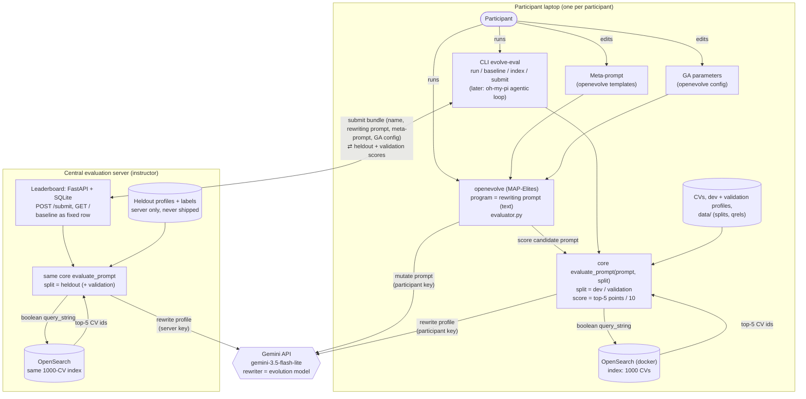

# tjf-evolve: Evolving LLM Query-Rewriting Prompts (Workshop Demo)

Status: outline / draft. Decisions marked **[decided]** come from the planning discussion; items under "Open points" still need an answer.

## 1. Goal

A production-near demo for a training workshop. A search profile (a long, structured staffing request) must be rewritten by an LLM into a boolean query that OpenSearch runs against consultant CVs. We use **openevolve** to evolve the *rewriting prompt* and measure each candidate against OpenSearch.

Participants can:
- edit the **meta-rewriting prompt** (the prompt that governs how openevolve's LLM mutates rewriting prompts),
- edit the **genetic-algorithm parameters** (islands, population, exploration ratio, ...),
- submit their best rewriting prompt to a **central leaderboard** and compare.

Optional later variant: no GA; an agentic loop (oh-my-pi) improves the prompt, using the same evaluation CLI.

### Terminology
| Term | Meaning |
|---|---|
| Search profile / query | One file in `queries/` (a staffing request) |
| Rewriting prompt | Plain-text prompt given to the rewriter LLM: profile in, boolean query out. **This is the evolved artifact.** |
| Meta-rewriting prompt | The prompt(s) that tell openevolve's evolution LLM how to improve rewriting prompts |
| GA parameters | openevolve config: islands, population, ratios, iterations, ... |
| Submission | Bundle of (participant name, rewriting prompt, meta-rewriting prompt, GA config) |

## 2. Existing assets

- `CVs/` – 1000 generated consultant CVs (`CV_NNNN_First_Last.txt`), sectioned text: summary, core skills (grouped), experience, education, certifications, languages. Planted against the queries (see 5a); file order does not reveal the planting.
- `queries/` – 100 generated search profiles (`<archetype>_NNN.txt`) with: role, engagement type, industry, minimum experience, MUST-HAVE / NICE-TO-HAVE skills, preferred certifications, language requirements, location/remote policy, project context.
- `query_generation.py`, `CV_generation.py` – generators. Run the query generator first, then the CV generator (it plants CVs against `queries/`). Both overwrite their output folders. Queries share the CV vocabulary (skills, certs, languages, locations).
- `src/evolve_demo/labels.py` – the labeler: parsers for CVs and queries, the label rules, the top-5 score. Used by the generator and later by the evaluation.
- Leftovers (`UpdatedResumeDataSet*.csv`, `node_modules`) were deleted by the user and are not needed.
- Ground truth is computed by the labeler (see 5); the labels are not stored in the repo yet (milestone 2).

## 3. Architecture



Components:
1. **OpenSearch** (docker-compose, single node, security disabled for the demo) with an index of the 1000 CVs.
2. **Relevance labels**: rule-based, computed offline from structured query and CV fields.
3. **Core evaluation function** (no openevolve dependency).
4. **openevolve integration**: evaluator wrapper, initial program (baseline prompt), config, meta-prompt templates.
5. **CLI wrapper** around the core function.
6. **Leaderboard server** (Option A) plus `submit` command.
7. **Optional**: oh-my-pi agentic variant.

## 4. Data and OpenSearch  **[implemented]**

- `docker-compose.yml`: one `opensearchproject/opensearch:3.9.0` node (latest release at the time of writing), security plugin disabled, heap 512 MB, bound to `127.0.0.1:9200`, named volume, healthcheck. **Tested** (Docker 29.9 / Compose 5.6 on WSL2): `docker compose up -d --wait` brings it to healthy (first start about 3.5 minutes, mostly the ~1 GB image pull), the container uses about 1 GB RAM, and the index survives `docker compose restart`. The sanity check gives identical numbers in the container and in an unpacked tarball.
- Index `cvs` (`src/evolve_demo/opensearch.py`, plain HTTP via `requests`, no client library). One document per CV, `_id` = CV file name without `.txt`. Fields: `name`, `location`, `title` (most recent role), `summary`, `skills` (text + keyword; list of the CORE SKILLS entries), `experience` (jobs and bullets), `certifications`, `languages` (e.g. "German (Native)"), `years_experience` (integer). Standard analyzer, no stemming. One shard, no replica.
- `scripts/index_cvs.py` waits for OpenSearch, recreates the index and loads all CVs (idempotent).
- Boolean text from the rewriter is run as a `query_string` query over `title^2, summary, skills^2, experience, certifications, languages`, default operator OR. Field prefixes (`skills:"Power BI"`) and numeric ranges (`years_experience:[6 TO *]`) work in the query text. Top 5 results are returned.
- A query OpenSearch rejects raises `QueryError`; the evaluation scores it 0 and reports the message as an artifact. Typical traps for rewriting prompts: unbalanced parentheses, a trailing `AND`, and unquoted slashes (`A/B testing` is a syntax error, `"A/B testing"` is fine).

### 4a. Sanity check  **[done]**

`scripts/oracle_check.py` builds simple boolean queries directly from the structured profiles (no LLM) and scores them with the top-5 metric, over all 100 profiles:

| Query built from the profile | Mean score | Profiles with score 0 |
|---|---|---|
| all must-haves as phrases, AND | 27.3% | 14 |
| must-haves as phrases, OR | 28.2% | 11 |
| must^3 + nice-to-haves + certs, OR | 33.7% | 3 |
| same + `years_experience` filter | 31.8% | 6 |

No query returned zero hits. So index, labels and metric work together, naive rule-following queries land at about 27–34%, and there is clear room above them: a perfect ranking reaches 68.5% on average (see the ceiling in section 5). These numbers give the evolved prompts a reference point; a reasonable baseline prompt should score near the lower end.

## 5. Relevance labels and metric  **[decided]**

Deliberately simple, so that participants and the evolving LLM can understand it at a glance.

**Per (profile, CV) pair a CV is:**

| Label | Points | Rules (all must hold) |
|---|---|---|
| Very good fit | 2 | covers **all** must-have skills; at least (minimum experience − 1) years; meets the required level in **at least one** required language; covers at least one nice-to-have skill **or** one preferred certification |
| Reasonable fit | 1 | misses **at most one** must-have skill; at least (minimum experience − 3) years; has at least one required language (any level); covers at least one nice-to-have skill or one preferred certification |
| Other | 0 | everything else |

**Score of a rewriting prompt on one profile:** run the rewritten boolean query, take the **top 5** results, add up their points, and divide by **10**, the theoretical maximum (five very good fits). Averaged over the queries of a split this gives a percentage. `combined_score` for openevolve is this percentage. The divisor is deliberately the same for every profile and not the best score reachable for that profile: in practice you do not know that best score either.

Details:
- **Skill evidence:** a skill counts if it is listed under CORE SKILLS **or** mentioned in the experience bullets. Bullet mentions are recognised through a table of aliases (`SKILL_ALIASES` in `labels.py`, e.g. "Kubernetes", "NLP" for Natural Language Processing). Skills without an alias (such as "Stakeholder management") can only be evidenced through CORE SKILLS. Certifications must be listed under CERTIFICATIONS.
- **Years of experience:** the number in the summary ("N years").
- **Language levels** share one ladder: Native > Fluent > Professional working proficiency (= "business level" in a profile) > Conversational. "Meets the level" means the CV level is at least the required one.
- **Profiles without certifications:** the nice-to-have/certification rule then rests on the nice-to-haves alone.
- **Ignored:** location, remote policy and industry have no influence on the label (CV locations are random noise and cannot be judged from a CV).
- **Order within the top 5 does not matter.** The score rewards getting the right CVs into the top 5, not their position.
- **Ceiling:** with 1–3 very good and 4–6 reasonable CVs planted per profile, the best possible top 5 is worth 6, 7 or 8 points, i.e. 60%, 70% or 80%; on average 68.5% over all 100 profiles (68.2% dev, 69.0% validation, 68.5% heldout). **A perfect prompt therefore cannot reach 100%**; participants should be told this up front, so that a leaderboard maximum of about 68% is read as "perfect". The ceiling is not stored in the qrels files; `labels.ceiling()` computes it as a diagnostic.
- Boolean queries that fail to parse score 0 for that profile and are reported as an artifact.
- Known risk: the task can degenerate to "list the must-have skills as OR terms". The planted near-misses and the "at most one missing" rule keep naive strategies visibly imperfect; an optional LLM-judge comparison for the final results stays possible.

### 5a. Data generation  **[decided, implemented]**

The first generated data had almost no matches (96 of 100 queries without a single very good CV), so the data was regenerated:
- 100 search profiles (unchanged in content; regenerated by `query_generation.py`).
- 1000 CVs. Per profile: **1–3 very good**, **4–6 reasonable** and **1–2 near-misses** (a CV that looks like a fit but fails exactly one hard rule: two must-haves missing, much too junior, none of the required languages, or no nice-to-have/cert). The remaining 159 CVs are distractors.
- About a quarter of the must-have skills of very good CVs are evidenced only in experience bullets, not in CORE SKILLS, so the search has to look at the full text.
- **Exact counts:** each CV is labelled against all 100 profiles while it is generated and is only kept if it matches exactly the profile it was planted for (and no other). Near-misses and distractors must match no profile at all. A re-read of the final files confirmed the counts: very good per profile 1/2/3 for 48/19/33 profiles, reasonable 4/5/6 for 26/37/37 profiles, reachable top-5 scores 6/7/8 points for 48/19/33 profiles.
- Consequence: 696 of the 1000 CVs are relevant to exactly one profile; no CV is relevant to two.

### Splits  **[decided]**
| Split | Share | Used for |
|---|---|---|
| dev | ~40 queries | evolution (what openevolve sees) |
| validation | ~20 queries | participants' own sanity check |
| heldout | ~40 queries | leaderboard only; stays on the server |

Splits are stratified by archetype (file name prefix) and fixed by a seed. Sizes: 40 / 20 / 40 profiles. Per archetype, dev gets 10/5/7/10/8 profiles (BI / cloud / data & analytics / data engineer / data scientist), validation 5/2/4/5/4, heldout 10/7/7/9/7.

### 5b. Qrels and splits files  **[decided, implemented]**

`scripts/make_qrels.py` (deterministic, seed 2026) labels every (profile, CV) pair with the labeler and writes:

| File | Content | Audience |
|---|---|---|
| `data/splits.json` | dev and validation profile ids | participants |
| `data/qrels.json` | labels (only 1 and 2 stored, all other pairs are 0) for the dev/validation profiles | participants |
| `heldout/heldout.json` | heldout profile ids and labels | **leaderboard server only** |

CV ids are the file names without `.txt`. Checked: splits are disjoint and complete, a fresh labeling reproduces every stored label, the best possible top 5 reaches exactly the profile's ceiling and an empty result scores 0%, and the participant files contain no heldout id.

**Packaging caveat:** the texts of the heldout profiles are still in `queries/`. The participant package must therefore exclude `heldout/` **and** the heldout profile files (ids in `heldout/heldout.json`). A packaging script is a milestone (see 13).

## 6. Core evaluation function

```python
evaluate_prompt(rewriting_prompt: str, split: str = "dev", cfg: EvalConfig | None = None) -> EvalResult
```
- For each query in the split: fill the prompt with the profile text, call the rewriter LLM, extract the boolean query, run it on OpenSearch, score the top 5 against the labels.
- Returns aggregated metrics, per-query results (rewritten query, score, errors).
- Prompt contract: the rewriting prompt contains a single placeholder (e.g. `{profile}`); evaluation validates this. Stray braces must be handled safely (use a replace instead of `str.format`; the `llm_prompt_optimization` example scores prompts 0 on stray braces, which we avoid).
- Parallel LLM calls with timeout, retry and on-disk caching keyed by (prompt hash, query id, model) to keep repeated evaluations cheap.
- Deterministic as far as possible: temperature 0 for the rewriter.

## 7. LLM backends  **[decided, implemented, not yet run against the real API]**

Two separate roles:
- **Rewriter model** (inside the evaluation): `gemini-3.5-flash-lite` (stable; confirmed in Google's model list).
- **Evolution model** (openevolve's `llm.models`): the same Gemini model **[decided]**; still configurable.

Providers, both through an OpenAI-compatible chat-completions endpoint:
- **Gemini API** (primary **[decided]**): `https://generativelanguage.googleapis.com/v1beta/openai`, API key as Bearer token, `GEMINI_API_KEY`.
- **OpenRouter** (optional): `https://openrouter.ai/api/v1`, `OPENROUTER_API_KEY`, model `google/gemini-3.5-flash-lite` (listed at $0.30 per million input and $2.50 per million output tokens; a 40-query evaluation should cost a few cents).

Client: `src/evolve_demo/llm.py` (requests only, no SDK). `complete(prompt, system=, temperature=, max_tokens=, reasoning_effort=)` with retries and exponential backoff on 429/5xx and connection errors (honours `Retry-After`), clear `LLMError`s, optional on-disk response cache (`LLM_CACHE_DIR`). Configuration through environment variables or a `.env` file (`.env.example` is provided, `.env` is in `.gitignore`): `LLM_PROVIDER`, `GEMINI_API_KEY` / `OPENROUTER_API_KEY`, `LLM_API_KEY`, `LLM_API_BASE`, `REWRITER_MODEL`, `LLM_CACHE_DIR`.

Tests: `tests/test_llm.py` (9 tests against a local fake server: request format, optional parameters, OpenRouter defaults, retry/give-up, no retry on 4xx, missing key, empty answer, cache). `scripts/llm_check.py` is a smoke test for the real endpoint.

Points to verify as soon as a key exists:
- Sampling: Google's guidance for Gemini 3 models is to keep the default temperature. The client therefore sends no temperature unless asked. Check how much the scores vary between repeated runs; the response cache keeps repeated evaluations of the same prompt stable.
- `max_tokens` includes the model's thinking tokens (answers can be cut off or empty if it is too small); `reasoning_effort` (`minimal` to `high`) may be useful to keep the rewriter fast and cheap.
- Rate limits of the free versus paid Gemini tier with several participants in parallel.

## 7a. Deployment model  **[decided]**

Each participant runs OpenSearch (docker) and openevolve **locally**. Only the leaderboard server is central.
- Participant repo contains CVs, dev + validation queries, `data/` (splits, qrels), the baseline and the CLI. **Heldout profiles and labels are not shipped to participants** (`heldout/` and the heldout profile files); they exist only on the leaderboard server, which also runs its own OpenSearch with the same index.
- Each participant needs their own LLM credentials (quota for evolution runs). The leaderboard server uses its own credentials for scoring submissions.
- Participant setup must be a one-command start (`docker compose up -d --wait`, then `python scripts/index_cvs.py`). Verified on WSL2; Linux/macOS/Windows still to be checked. Group membership for Docker applies only after a fresh login (we hit this once), which belongs in the setup instructions.

## 8. openevolve integration

Based on `examples/llm_prompt_optimization` in the openevolve repo (`/home/michael_wsl/repos/openevolve`), with these deviations:
- The program is `initial_prompt.txt` (the baseline rewriting prompt). `language: text`, `diff_based_evolution: false` (full rewrites). EVOLVE-BLOCK enforcement is probably not needed. To verify with openevolve's code before building.
- `evaluator.py` is a thin wrapper: reads `program_path`, calls `evaluate_prompt(..., split="dev")`, returns `combined_score` plus metrics. Rewritten queries and errors go into artifacts (`include_artifacts: true`) so the evolution LLM can see what failed.
- Do not copy the example's quirks: the same model used for evolution and task, fixed first-N sample subsets without shuffling, plain-dict returns that leave artifacts empty.
- Cascade evaluation is optional: stage 1 on a small dev subset, stage 2 on all of dev.
- **Meta-rewriting prompts**: custom templates in `meta/templates/` via `prompt.template_dir`, including the system message. Workshop exercise 1 edits these.
- **GA parameters**: `configs/evolve.yaml`, documented with comments. Workshop exercise 2 edits these (num_islands, population_size, exploration/exploitation ratio, feature dimensions, iterations).
- Feature dimensions: consider query length or number of boolean operators as MAP-Elites dimensions to make the diversity visible; decide after a first run.
- Results land in an output directory per participant; `best/` holds the best prompt.

## 9. CLI (`evolve-eval`)

- `evolve-eval run --prompt-file p.txt --split dev|validation [--json]` – prints metrics (and per-query details with `--details`).
- `evolve-eval baseline` – scores the baseline prompt.
- `evolve-eval submit --name NAME --rewriting-prompt best.txt --meta-prompt meta/... --config configs/evolve.yaml` – posts a submission to the leaderboard.
- `evolve-eval qrels|index` – helper commands for setup.
- Stable JSON output so an oh-my-pi agent can call it as a tool.

## 10. Leaderboard (Option A)  **[decided]**

- FastAPI single-file app + SQLite, run by the instructor next to OpenSearch.
- `POST /submit`: validates the bundle, queues scoring of the rewriting prompt on the **heldout** split (and validation for reference) using the same core function, stores bundle and scores.
- `GET /`: HTML table: rank, participant, heldout score, validation score, timestamp, link to the submitted prompts and config. Baseline is pre-submitted as a fixed row.
- Protection: per-participant rate limit, max prompt size, simple shared workshop token. No heavy authentication.
- Heldout queries and qrels never leave the server; participants only get a score back.
- Scoring of one submission takes seconds to a minute; the table shows "evaluating" state.

## 11. Optional: agentic variant (oh-my-pi)

- Same evaluation CLI as the tool; an agent edits `prompt.txt`, runs `evolve-eval run`, reads the results and per-query failures, iterates.
- Decide after the core path works; the only requirement now is to keep the CLI output machine-readable.

## 12. Proposed repository layout

```
CVs/  queries/                     existing data
data/qrels.json  data/splits.json  labels and split manifest; heldout labels server-only
docker-compose.yml                 OpenSearch (+ leaderboard service later)
scripts/index_cvs.py make_qrels.py oracle_check.py  (exist)
query_generation.py CV_generation.py   data generators (move into scripts/ later)
src/evolve_demo/                   labels.py, opensearch.py, llm.py (exist); core eval, CLI
evolve/initial_prompt.txt          baseline rewriting prompt
evolve/evaluator.py                openevolve wrapper
evolve/configs/evolve.yaml         GA parameters
evolve/meta/templates/             meta-rewriting prompts
leaderboard/app.py                 FastAPI + SQLite
README.md / workshop exercises
```

## 13. Milestones

1. OpenSearch up + CV indexing: **done** (4, 4a), including the Docker test.
2. Data, labeler, qrels, splits: **done** (5, 5a, 5b). Still open: sanity check with an oracle query built from a profile once OpenSearch runs.
3. LLM client (Gemini, OpenRouter): **done, tested against a fake server only**. Core evaluation function + baseline prompt score: open.
4. CLI wrapper.
5. openevolve wiring; first small evolution run; verify the score improves on dev and transfers to validation.
6. Meta-prompt templates and documented GA config; exercise sheet.
7. Leaderboard server + `submit`, and a packaging script that builds the participant repo without heldout profiles and labels.
8. Dry run with a few participants (cost and latency check).
9. Optional: oh-my-pi variant.

## 14. Open points

1. **Gemini API key and quota**: how do ~N participants get keys (own keys, or a shared workshop key), and which rate limits apply? A key is also needed to run the smoke test (`scripts/llm_check.py`).
2. **Where the leaderboard runs** (instructor laptop, VM) and network reachability from participants.
3. **openevolve details to verify** (not analyzed yet): text-file programs with `language: text`, artifacts flow into prompts, `evaluator.py` cascade/timeout, template overriding.
