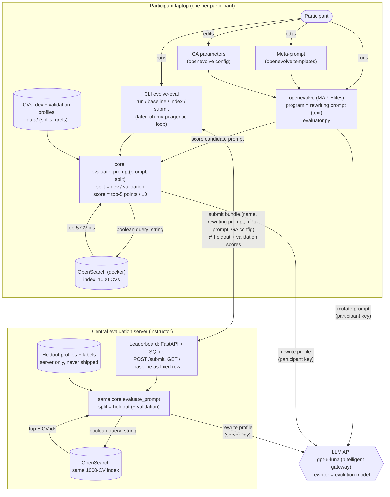

# tjf-evolve: Evolving LLM Query-Rewriting Prompts (Workshop Demo)

Status: outline / draft. Decisions marked **[decided]** come from the planning discussion; items under "Open points" still need an answer.

## 1. Goal

A production-near demo for a training workshop. A search profile (a long, structured staffing request) must be rewritten by an LLM into a boolean query that OpenSearch runs against consultant CVs. We use **openevolve** to evolve the *rewriting prompt* and measure each candidate against OpenSearch.

Participants can:
- edit the **meta-rewriting prompt** (the prompt that governs how openevolve's LLM mutates rewriting prompts),
- edit the **genetic-algorithm parameters** (islands, population, exploration ratio, ...),
- submit their best rewriting prompt to a **central leaderboard** and compare.

Optional later variant: no GA; an agentic loop (oh-my-pi) improves the prompt, using the same evaluation CLI.

### Terminology
| Term | Meaning |
|---|---|
| Search profile / query | One file in `queries/` (a staffing request) |
| Rewriting prompt | Plain-text prompt given to the rewriter LLM: profile in, boolean query out. **This is the evolved artifact.** |
| Meta-rewriting prompt | The prompt(s) that tell openevolve's evolution LLM how to improve rewriting prompts |
| GA parameters | openevolve config: islands, population, ratios, iterations, ... |
| Submission | Bundle of (participant name, rewriting prompt, meta-rewriting prompt, GA config) |

## 2. Existing assets

- `CVs/` – 1000 generated consultant CVs (`CV_NNNN_First_Last.txt`), sectioned text: summary, core skills (grouped), experience, education, certifications, languages. Planted against the queries (see 5a); file order does not reveal the planting.
- `queries/` – 100 generated search profiles (`<archetype>_NNN.txt`) with: role, engagement type, industry, minimum experience, MUST-HAVE / NICE-TO-HAVE skills, preferred certifications, language requirements, location/remote policy, project context.
- `query_generation.py`, `CV_generation.py` – generators. Run the query generator first, then the CV generator (it plants CVs against `queries/`). Both overwrite their output folders. Queries share the CV vocabulary (skills, certs, languages, locations).
- `src/evolve_demo/labels.py` – the labeler: parsers for CVs and queries, the label rules, the top-5 score. Used by the generator and later by the evaluation.
- Leftovers (`UpdatedResumeDataSet*.csv`, `node_modules`) were deleted by the user and are not needed.
- Ground truth is computed by the labeler (see 5); the labels are not stored in the repo yet (milestone 2).

## 3. Architecture



Components:
1. **OpenSearch** (docker-compose, single node, security disabled for the demo) with an index of the 1000 CVs.
2. **Relevance labels**: rule-based, computed offline from structured query and CV fields.
3. **Core evaluation function** (no openevolve dependency).
4. **openevolve integration**: evaluator wrapper, initial program (baseline prompt), config, meta-prompt templates.
5. **CLI wrapper** around the core function.
6. **Leaderboard server** (Option A) plus `submit` command.
7. **Optional**: oh-my-pi agentic variant.

## 4. Data and OpenSearch  **[implemented]**

- `docker-compose.yml`: one `opensearchproject/opensearch:3.9.0` node (latest release at the time of writing), security plugin disabled, heap 512 MB, bound to `127.0.0.1:9200`, named volume, healthcheck. **Tested** (Docker 29.9 / Compose 5.6 on WSL2): `docker compose up -d --wait` brings it to healthy (first start about 3.5 minutes, mostly the ~1 GB image pull), the container uses about 1 GB RAM, and the index survives `docker compose restart`. The sanity check gives identical numbers in the container and in an unpacked tarball.
- Index `cvs` (`src/evolve_demo/opensearch.py`, plain HTTP via `requests`, no client library). One document per CV, `_id` = CV file name without `.txt`. Fields: `name`, `location`, `title` (most recent role), `summary`, `skills` (text + keyword; list of the CORE SKILLS entries), `experience` (jobs and bullets), `certifications`, `languages` (e.g. "German (Native)"), `years_experience` (integer). Standard analyzer, no stemming. One shard, no replica.
- `evolve-eval index` waits for OpenSearch, recreates the index and loads all CVs (idempotent).
- Boolean text from the rewriter is run as a `query_string` query over `title^2, summary, skills^2, experience, certifications, languages`, default operator OR. Field prefixes (`skills:"Power BI"`) and numeric ranges (`years_experience:[6 TO *]`) work in the query text. Top 5 results are returned.
- A query OpenSearch rejects raises `QueryError`; the evaluation scores it 0 and reports the message as an artifact. Typical traps for rewriting prompts: unbalanced parentheses, a trailing `AND`, and unquoted slashes (`A/B testing` is a syntax error, `"A/B testing"` is fine).

### 4a. Sanity check  **[done]**

`scripts/oracle_check.py` builds simple boolean queries directly from the structured profiles (no LLM) and scores them with the top-5 metric, over all 100 profiles:

| Query built from the profile | Mean score | Profiles with score 0 |
|---|---|---|
| all must-haves as phrases, AND | 27.3% | 14 |
| must-haves as phrases, OR | 28.2% | 11 |
| must^3 + nice-to-haves + certs, OR | 33.7% | 3 |
| same + `years_experience` filter | 31.8% | 6 |

No query returned zero hits. So index, labels and metric work together, naive rule-following queries land at about 27–34%, and there is clear room above them: a perfect ranking reaches 68.5% on average (see the ceiling in section 5). These numbers give the evolved prompts a reference point; a reasonable baseline prompt should score near the lower end.

## 5. Relevance labels and metric  **[decided]**

Deliberately simple, so that participants and the evolving LLM can understand it at a glance.

**Per (profile, CV) pair a CV is:**

| Label | Points | Rules (all must hold) |
|---|---|---|
| Very good fit | 2 | covers **all** must-have skills; at least (minimum experience − 1) years; meets the required level in **at least one** required language; covers at least one nice-to-have skill **or** one preferred certification |
| Reasonable fit | 1 | misses **at most one** must-have skill; at least (minimum experience − 3) years; has at least one required language (any level); covers at least one nice-to-have skill or one preferred certification |
| Other | 0 | everything else |

**Score of a rewriting prompt on one profile:** run the rewritten boolean query, take the **top 5** results, add up their points, and divide by **10**, the theoretical maximum (five very good fits). Averaged over the queries of a split this gives a percentage. `combined_score` for openevolve is this percentage. The divisor is deliberately the same for every profile and not the best score reachable for that profile: in practice you do not know that best score either.

Details:
- **Skill evidence:** a skill counts if it is listed under CORE SKILLS **or** mentioned in the experience bullets. Bullet mentions are recognised through a table of aliases (`SKILL_ALIASES` in `labels.py`, e.g. "Kubernetes", "NLP" for Natural Language Processing). Skills without an alias (such as "Stakeholder management") can only be evidenced through CORE SKILLS. Certifications must be listed under CERTIFICATIONS.
- **Years of experience:** the number in the summary ("N years").
- **Language levels** share one ladder: Native > Fluent > Professional working proficiency (= "business level" in a profile) > Conversational. "Meets the level" means the CV level is at least the required one.
- **Profiles without certifications:** the nice-to-have/certification rule then rests on the nice-to-haves alone.
- **Ignored:** location, remote policy and industry have no influence on the label (CV locations are random noise and cannot be judged from a CV).
- **Order within the top 5 does not matter.** The score rewards getting the right CVs into the top 5, not their position.
- **Ceiling:** with 1–3 very good and 4–6 reasonable CVs planted per profile, the best possible top 5 is worth 6, 7 or 8 points, i.e. 60%, 70% or 80%; on average 68.5% over all 100 profiles (68.2% dev, 69.0% validation, 68.5% heldout). **A perfect prompt therefore cannot reach 100%**; participants should be told this up front, so that a leaderboard maximum of about 68% is read as "perfect". The ceiling is not stored in the qrels files; `labels.ceiling()` computes it as a diagnostic.
- Boolean queries that fail to parse score 0 for that profile and are reported as an artifact.
- Known risk: the task can degenerate to "list the must-have skills as OR terms". The planted near-misses and the "at most one missing" rule keep naive strategies visibly imperfect; an optional LLM-judge comparison for the final results stays possible.

### 5a. Data generation  **[decided, implemented]**

The first generated data had almost no matches (96 of 100 queries without a single very good CV), so the data was regenerated:
- 100 search profiles (unchanged in content; regenerated by `query_generation.py`).
- 1000 CVs. Per profile: **1–3 very good**, **4–6 reasonable** and **1–2 near-misses** (a CV that looks like a fit but fails exactly one hard rule: two must-haves missing, much too junior, none of the required languages, or no nice-to-have/cert). The remaining 159 CVs are distractors.
- About a quarter of the must-have skills of very good CVs are evidenced only in experience bullets, not in CORE SKILLS, so the search has to look at the full text.
- **Exact counts:** each CV is labelled against all 100 profiles while it is generated and is only kept if it matches exactly the profile it was planted for (and no other). Near-misses and distractors must match no profile at all. A re-read of the final files confirmed the counts: very good per profile 1/2/3 for 48/19/33 profiles, reasonable 4/5/6 for 26/37/37 profiles, reachable top-5 scores 6/7/8 points for 48/19/33 profiles.
- Consequence: 696 of the 1000 CVs are relevant to exactly one profile; no CV is relevant to two.

### Splits  **[decided]**
| Split | Share | Used for |
|---|---|---|
| dev | ~40 queries | evolution (what openevolve sees) |
| validation | ~20 queries | participants' own sanity check |
| heldout | ~40 queries | leaderboard only; stays on the server |

Splits are stratified by archetype (file name prefix) and fixed by a seed. Sizes: 40 / 20 / 40 profiles. Per archetype, dev gets 10/5/7/10/8 profiles (BI / cloud / data & analytics / data engineer / data scientist), validation 5/2/4/5/4, heldout 10/7/7/9/7.

### 5b. Qrels and splits files  **[decided, implemented]**

`scripts/make_qrels.py` (deterministic, seed 2026) labels every (profile, CV) pair with the labeler and writes:

| File | Content | Audience |
|---|---|---|
| `data/splits.json` | dev and validation profile ids | participants |
| `data/qrels.json` | labels (only 1 and 2 stored, all other pairs are 0) for the dev/validation profiles | participants |
| `heldout/heldout.json` | heldout profile ids and labels | **leaderboard server only** |

CV ids are the file names without `.txt`. Checked: splits are disjoint and complete, a fresh labeling reproduces every stored label, the best possible top 5 reaches exactly the profile's ceiling and an empty result scores 0%, and the participant files contain no heldout id.

**Packaging caveat:** the texts of the heldout profiles are still in `queries/` of this (instructor) repo. Never hand out this repo itself; build the participant package with `scripts/package_participant.py` (section 7a), which leaves out `heldout/` and the heldout profile files and checks for leaks.

## 6. Core evaluation function  **[implemented]**

`src/evolve_demo/evaluate.py`, no openevolve dependency:
```python
evaluate_prompt(prompt, split="dev", *, workers=8, limit=None, model=None, max_tokens=4096, reasoning_effort=None) -> dict
```
- For each profile of the split: insert the profile text at `{profile}` (plain `replace`, not `str.format`, so other braces are harmless), call the rewriter LLM, strip whitespace and a Markdown code fence, run the query on OpenSearch, score the top 5 against the labels.
- Returns `combined_score` (mean over profiles, 0..1), `n_errors`, `n_zero`, `avg_query_chars` (candidate MAP-Elites feature), `model`, `seconds`, and `per_profile` (id, score, points, query, top ids, error, seconds).
- `PromptError` for an unusable prompt (no `{profile}`, longer than 20,000 characters). Per-profile LLM errors, query syntax errors and empty queries cost that profile's points and are reported, never raised.
- 8 parallel LLM calls; the optional response cache (`LLM_CACHE_DIR`) makes repeated evaluations of the same prompt free and identical. No temperature is set (model default).
- The heldout split loads from `heldout/heldout.json`, which only exists on the server.
- Called through the CLI (`evolve-eval run` / `baseline`, section 9); `python -m evolve_demo.evaluate PROMPT_FILE --split S` remains as a developer shortcut (also allows `heldout` where the file exists).
- Tests: `tests/test_evaluate.py` (placeholder, braces, code fences, splits).

**Baseline** (`evolve/initial_prompt.txt`, a deliberately plain prompt): **dev 9.5% / 8.0% / 8.5%** in three runs (noise about ±1 point), ~31 s per run with `gpt-6-luna`. **Validation 4.0%** (15 of 20 profiles at 0, 18 s). Typical failure: the model ANDs every requirement, including location, industry and years as text, so 27 of 40 queries return no hits at all. That leaves a lot of room up to the oracle strategies (27–34%) and the ceiling (68.5%), and it is an instructive first thing for the evolution to fix.

**Keep the baseline weak [decided]:** the jump from "AND everything" to working queries is a deliberate learning opportunity for the participants. Do not "improve" `initial_prompt.txt`.

## 7. LLM backends  **[decided, implemented, verified against the b.telligent gateway]**

Two separate roles:
- **Rewriter model** (inside the evaluation): `gpt-6-luna` via the b.telligent chat gateway **[decided, switched from Gemini]**.
- **Evolution model** (openevolve's `llm.models`): the same model **[decided]**; still configurable.

Providers, all through an OpenAI-compatible chat-completions endpoint:
- **btelligent** (default **[decided]**): `https://chat.btelligent.com/api` (`/chat/completions`, `/models`), API key as Bearer token, `BTELLIGENT_API_KEY`, model `gpt-6-luna`.
- **Gemini API** (alternative): `https://generativelanguage.googleapis.com/v1beta/openai`, `GEMINI_API_KEY`, model `gemini-3.5-flash-lite`.
- **OpenRouter** (alternative): `https://openrouter.ai/api/v1`, `OPENROUTER_API_KEY`, model `google/gemini-3.5-flash-lite`.

Client: `src/evolve_demo/llm.py` (requests only, no SDK). `complete(prompt, system=, temperature=, max_tokens=, reasoning_effort=)` sends `stream: false`, retries with exponential backoff on 429/5xx and connection errors (honours `Retry-After`), raises clear `LLMError`s, optional on-disk response cache (`LLM_CACHE_DIR`). `list_models()` returns the model ids the endpoint offers. Configuration through environment variables (preferred: export the key in the shell, see `participant_instructions.md`) or a `.env` file (`.env.example`, gitignored): `LLM_PROVIDER`, `BTELLIGENT_API_KEY` / `GEMINI_API_KEY` / `OPENROUTER_API_KEY`, `LLM_API_KEY`, `LLM_API_BASE`, `REWRITER_MODEL`, `LLM_CACHE_DIR`.

Tests: `tests/test_llm.py` (10 tests against a local fake server). `evolve-eval check` checks that the model is offered and sends one tiny request.

Verified with the real gateway: `gpt-6-luna` is offered (18 models), accepts `max_tokens` and `stream: false`, answers in 2–10 s; a 40-profile evaluation takes ~31 s with 8 parallel calls, no rate-limit errors so far.
Still to check: `reasoning_effort` and `temperature` support, rate limits with many participants in parallel.

## 7a. Deployment model  **[decided]**

Each participant runs OpenSearch (docker) and openevolve **locally**. Only the leaderboard server is central.
- Participant repo contains CVs, dev + validation queries, `data/` (splits, qrels), the baseline and the CLI. **Heldout profiles and labels are not shipped to participants** (`heldout/` and the heldout profile files); they exist only on the leaderboard server, which also runs its own OpenSearch with the same index.
- Each participant needs their own LLM credentials (quota for evolution runs). The leaderboard server uses its own credentials for scoring submissions.
- **Participant package** **[implemented]**: `uv run python scripts/package_participant.py OUTPUT_DIR [--force] [--zip] [--git]` (OUTPUT_DIR must be outside the repo). Copies an allowlist (`.env.example`, `.gitignore`, `CVs/`, `data/qrels.json`, `data/splits.json`, `docker-compose.yml`, `evolve/` without runs, `participant_instructions.md`, `pyproject.toml`, `uv.lock`, `src/evolve_demo/`, `tests/`) plus only the 60 dev and validation profiles from `queries/`, and writes a short `README.md`. Left out on purpose: `heldout/`, the 40 heldout profiles, `PLAN.md`, the data generators and `scripts/` (with them the heldout labels could be regenerated), runs, caches, `.env`, the leaderboard database. Afterwards every text file is scanned for heldout profile ids, heldout profile files and a `heldout/` folder; on a hit the package is deleted and the script fails. `--git` creates a repository with one commit, `--zip` a zip archive next to the folder (3.2 MB, 1086 files).
  Verified: the scan catches a planted heldout profile file, a mention of a heldout id and a `heldout/` folder. In the built package, the tests pass (leaderboard tests skipped without the `server` extra), `evolve-eval check` is ok, and `baseline` and `run --split validation` score normally.
- Participant setup must be a one-command start (`docker compose up -d --wait`, then `uv run evolve-eval index`). Verified on WSL2; Linux/macOS/Windows still to be checked. Group membership for Docker applies only after a fresh login (we hit this once), which belongs in the setup instructions.

## 8. openevolve integration  **[implemented, smoke-tested]**

openevolve **0.4.0 from PyPI** (dependency in `pyproject.toml`; run with `uv run openevolve-run …`). Note: the PyPI 0.4.0 is older than the git checkout in `/home/michael_wsl/repos/openevolve` with the same version number; it has no `evaluator.evaluator_args` and no `prompt.island_system_messages`. Everything below was verified against the installed PyPI code.

Run (from the repo root, key exported):
```bash
uv run openevolve-run evolve/initial_prompt.txt evolve/evaluator.py \
    --config evolve/configs/evolve.yaml --output evolve/runs/<name> [--iterations N]
```
Results: `evolve/runs/<name>/best/best_program.txt` (best prompt), `checkpoints/checkpoint_N/` (all programs with metrics, feedback and the logged evolution prompts). `evolve/runs/` is gitignored.

Files:
- `evolve/initial_prompt.txt` – the program. The `.txt` suffix is taken over for candidate files; `language: text` and `diff_based_evolution: false` make every candidate a full rewrite. openevolve extracts the candidate from the evolution LLM's answer as the first ` ```text ` block (fallback: first code block, then the whole answer), so the meta-prompt asks for exactly one ` ```text ` block and no triple backticks inside the prompt.
- `evolve/evaluator.py` – `evaluate(program_path)` calls the core `evaluate_prompt(prompt, "dev")` and returns an `EvaluationResult`:
  - metrics (numbers only): `combined_score` (fitness), `n_zero`, `n_errors`, `prompt_length`, `avg_query_chars`;
  - artifact `feedback`: score summary, count of zero-score / no-hit / failed queries, the 4 worst and 2 best dev profiles with their must-have/nice-to-have/certification/min-years summary, the generated query and any error. It is rendered into the `{artifacts}` section of the meta-prompt (openevolve redacts only 32+ character alphanumeric tokens, which our ids are not).
  - A prompt without `{profile}` scores 0 with a feedback message; setup failures (OpenSearch down) raise, and openevolve logs them.
  - `EVOLVE_EVAL_LIMIT=N` scores only the first N dev profiles (cheap smoke tests).
- `evolve/configs/evolve.yaml` – the **GA parameters** (exercise 2), commented: 20 iterations, 2 islands, population 40, archive 20, feature dimensions `prompt_length` × `avg_query_chars` with 6 bins each, 2 parallel evaluations, no cascade, evolution model `gpt-6-luna` on the gateway with `api_key: "${BTELLIGENT_API_KEY}"` (resolved by openevolve from the environment), temperature 0.7. openevolve also sends `seed` (from `random_seed: 42`); the gateway accepts `temperature`, `seed`, `top_p` and `reasoning_effort` (checked).
- `evolve/meta/templates/` – the **meta-prompt** (exercise 1), loaded via `prompt.template_dir` (resolved relative to the config file); files override openevolve's defaults by name:
  - `system_message.txt` – explains the system (profile → rewriting prompt → LLM → query_string on 1000 CVs → top-5 points), the goal, and that unparseable or empty-result queries score 0. Deliberately gives no solution hints (no field names, no "use OR"): finding those is what participants can add. Used verbatim (not passed through `str.format`).
  - `full_rewrite_user.txt` – score, metrics, feedback, evolution history, current prompt, requirements (keep `{profile}` once, query-only answers, no triple backticks) and the answer format. It *is* passed through `str.format`, so literal braces must be doubled (`{{profile}}`).
  - All other templates (history, top programs, …) are openevolve's defaults; programs appear there in ` ```text ` blocks.
- Cascade evaluation is off; a stage-1 subset could be added later as a GA option.

**20-iteration run** (default config, 7 min, 21 evaluations × 40 rewriter calls + 20 evolution calls, no errors): baseline 6.3% → 26.8% (iteration 2) → 30.3% (4) → **32.0% (iteration 8)**, then no further improvement in iterations 9–20 (candidates between 9.5% and 28.5%; both islands end at 32.0%). The best prompt scores **35.0% on validation** (1 of 20 profiles at 0). Its strategy: a pure OR query of synonym groups for several must-have concepts plus a few nice-to-haves, no AND, no field names, nothing about years/language/location; i.e. the evolution rediscovers the best hand-written oracle strategy (`must^3 + nice + certs, OR`: 33.7%) and stalls there.
Consequence for the workshop: the default setup reliably gets from ~6% to ~30% within 5–8 iterations (about 3–4 minutes); going beyond needs ideas the evolution model does not find on its own (e.g. field boosts like `skills:"…"^3`, the `years_experience` field, weighting must-haves over nice-to-haves). That is exactly the lever of exercise 1 (meta-prompt: tell the evolution model about the index fields and the scoring rules) and exercise 2 (GA parameters: more exploration, more islands, temperature). Variance between runs is still to be measured.

**Smoke test** (5 iterations, full dev split, 2 min 44 s): baseline 5.5% → best **28.0%** (iteration 2; others 25.8%, 26.3%, 23.5%, 17.8%). The best prompt is concise and ORs title/skill synonym groups with at most two ANDs, dropping location, language, industry and years. It scores **31.5% on validation** (baseline 4.0%), so the improvement transfers. Cost per iteration: ~3,300 tokens for the evolution call plus 40 rewriter calls. The logged evolution prompts confirm that our system message, the feedback block and the literal `{profile}` reach the evolution model.

## 9. CLI (`evolve-eval`)  **[implemented]**

`src/evolve_demo/cli.py`, installed as a console script by `pyproject.toml`; run with `uv run evolve-eval …` (uv creates `.venv/` on first use).
- `evolve-eval check` – OpenSearch reachable, index complete (1000 CVs), model offered by the endpoint, one tiny LLM call.
- `evolve-eval index [--wait S]` – (re)creates the index and loads `CVs/`.
- `evolve-eval run PROMPT_FILE|- [--split dev|validation] [--limit N] [--workers N] [--details]` – scores a rewriting prompt (`-` reads stdin).
- `evolve-eval baseline [same options]` – scores `evolve/initial_prompt.txt`.
- `evolve-eval submit PROMPT_FILE --name NAME [--meta-dir evolve/meta/templates] [--config evolve/configs/evolve.yaml] [--server URL] [--wait] [--wait-timeout 900]` – sends the bundle to the leaderboard (`LEADERBOARD_URL`, `LEADERBOARD_TOKEN`); checks the prompt locally first; with `--wait` it polls until the submission is scored and prints the scores. Wrong token or unreachable server → setup error; rejected submission → input error with the server's reason.
- Output contract for scripts and agents: exactly one JSON object on stdout, progress on stderr. Exit code 0 ok, 1 invalid input (prompt, arguments; `{"error", "kind": "input"}`), 2 setup problem (no key, wrong key, OpenSearch down; `{"error", "kind": "setup"}`). The heldout split is not selectable. A run checks key and OpenSearch first, so no LLM calls are wasted on a broken setup; if every LLM call fails, it is reported as a setup error instead of a score of 0.
- Tests: `tests/test_cli.py` (argument errors, unreadable file, missing key, OpenSearch down). Also verified by hand against the real gateway: `check` ok (LLM answer in 1.3 s), `index` 1000 CVs, wrong key → setup error (HTTP 401), prompt without `{profile}` → input error, `--split heldout` → input error, OpenSearch down → setup error before any LLM call.
- Replaced and removed: `scripts/index_cvs.py` (→ `index`), `scripts/llm_check.py` (→ `check`), `requirements.txt` (→ `pyproject.toml`).

## 10. Leaderboard (Option A)  **[implemented, tested end to end]**

`src/evolve_demo/leaderboard.py`, FastAPI + SQLite, run by the instructor on a machine that also has OpenSearch with the CV index and the `heldout/` folder:
```bash
export LEADERBOARD_TOKEN=...            # shared workshop token, handed out to participants
uv run --extra server evolve-leaderboard --host 0.0.0.0 --port 8000
```
FastAPI and uvicorn are an optional `server` extra, so participants do not install them. Note: a plain `uv run …` syncs the environment without the extra and removes them again; on the server always use `uv run --extra server …`.
- Configuration: `LEADERBOARD_TOKEN` (required), `LEADERBOARD_DB` (default `leaderboard.sqlite3` in the repo root, gitignored), plus the usual LLM settings with the **server's own key** and OpenSearch settings. Default bind is `127.0.0.1`; `--host 0.0.0.0` makes it reachable from other machines.
- `POST /submit` (header `Authorization: Bearer <token>`): JSON bundle `participant` (1–40 characters), `rewriting_prompt` (must contain `{profile}`, at most 20,000 characters), `meta_prompt` (`{file name: text}`, at most 50,000 characters together), `ga_config` (text, at most 20,000 characters). Rejected: wrong token (401), invalid prompt or the reserved name "baseline" (400), a participant whose previous submission is still queued or being scored, or who submitted less than 120 s ago (429).
- Scoring: one background worker, one submission at a time (keeps the gateway load predictable): heldout split (ranking) and validation (reference), ~60 LLM calls, about 1 minute. A submission where every profile fails (e.g. gateway down) is marked `failed` with the error instead of scoring 0. Queued or interrupted submissions are re-queued when the server restarts.
- `GET /`: ranked HTML table (heldout score, validation score, status, time; earlier submission wins ties), refreshes every 10 s, light and dark mode. The baseline is submitted automatically on first start and shown as a highlighted row. `GET /submission/{id}`: the submitted rewriting prompt, meta-prompt files and GA config (all participant input is HTML-escaped).
- `GET /api/submissions`, `GET /api/submissions/{id}`: JSON with id, participant, time, status, scores, number of heldout profiles at 0, error. Heldout queries, generated queries and per-profile results are never exposed.
- No real authentication: anyone with the token can submit under any name (accepted for a workshop).
- Tests: `tests/test_leaderboard.py` (ranking with baseline row, token/prompt/name/size rejections, one pending submission per participant, HTML escaping, no heldout details in the API), with a fake scoring function; skipped when the `server` extra is not installed.
- **End-to-end test** (real gateway and OpenSearch, scratch database): baseline heldout **7.0%** / validation 3.0% (32 of 40 heldout profiles at 0); the 5-iteration smoke-test prompt heldout **20.0%** / validation 30.0% (dev 28.0%). Wrong token and an early resubmission were rejected with clear messages.

## 11. Optional: agentic variant (oh-my-pi)

- Same evaluation CLI as the tool; an agent edits `prompt.txt`, runs `evolve-eval run`, reads the results and per-query failures, iterates.
- Decide after the core path works; the only requirement now is to keep the CLI output machine-readable.

## 12. Proposed repository layout

```
CVs/  queries/                     existing data
data/qrels.json  data/splits.json  labels and split manifest; heldout labels server-only
docker-compose.yml                 OpenSearch (+ leaderboard service later)
scripts/make_qrels.py oracle_check.py package_participant.py   instructor tools (uv run python scripts/...)
query_generation.py CV_generation.py   data generators (move into scripts/ later)
src/evolve_demo/                   labels.py, opensearch.py, llm.py, evaluate.py, cli.py, leaderboard.py
pyproject.toml uv.lock             package + `evolve-eval` console script (uv)
tests/                             unit tests: uv run python -m unittest discover tests
evolve/initial_prompt.txt          baseline rewriting prompt (keep it weak)
evolve/evaluator.py                openevolve wrapper (metrics + feedback artifact)
evolve/configs/evolve.yaml         GA parameters
evolve/meta/templates/             meta-prompt: system_message.txt, full_rewrite_user.txt
evolve/runs/                       openevolve output per run (gitignored)
README.md / workshop exercises
```

## 13. Milestones

1. OpenSearch up + CV indexing: **done** (4, 4a), including the Docker test.
2. Data, labeler, qrels, splits: **done** (5, 5a, 5b), oracle sanity check done (4a).
3. LLM client (b.telligent gateway, Gemini, OpenRouter): **done, verified against the real gateway**. Core evaluation function + baseline prompt score: **done** (dev ≈ 9%, validation 4%).
4. CLI wrapper: **done** (including `submit`).
5. openevolve wiring; first small evolution run; verify the score improves on dev and transfers to validation: **done** (5 iterations: dev 5.5% → 28.0%, validation 4.0% → 31.5%).
6. Meta-prompt templates and documented GA config; exercise sheet.
7. Leaderboard server + `submit`: **done**, tested end to end on localhost. Packaging script: **done** (`scripts/package_participant.py`, with leak scan). Still open: deployment (where it runs, network).
8. Dry run with a few participants (cost and latency check).
9. Optional: oh-my-pi variant.

## 14. Open points

1. **Rate limits on the b.telligent gateway** with ~N participants in parallel (every participant has their own key **[decided]**; access confirmed).
2. **Where the leaderboard runs** (instructor laptop, VM) and network reachability from participants; how the workshop token is handed out. The server needs Docker/OpenSearch, the `heldout/` folder and its own API key.
3. **Run length for the workshop**: the default config plateaus at ~32% dev after ~8 iterations (20 iterations ≈ 7 min). Still to measure: variance between runs, and whether a meta-prompt with index/scoring hints breaks through the plateau (would make a good demo for exercise 1).
